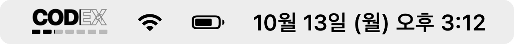
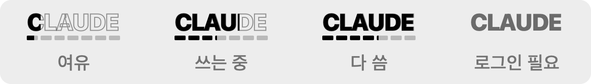
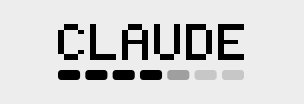

# Hando

AI 쓸 때 Claude / Codex 한도를 상시 확인하고 싶어서 만든 메뉴바 앱




글자는 5시간, 아래 잔디는 주간 사용량. 쓸수록 채워지고, 다 쓰면 몇 초마다 글자가 움직임



## 꾸미기

글꼴 7개, 한도 다 찼을 때 움직임 5개 중에 팝오버에서 고를 수 있음




## 설치

```bash
brew install --cask minsu33/tap/hando
```

또는 [Releases](https://github.com/minsu33/Hando/releases)에서 zip 받아서 응용 프로그램 폴더에 넣기

Apple 공증이 없어서 처음엔 막힘 → 시스템 설정 › 개인정보 보호 및 보안 › **그래도 열기**
(아니면 `xattr -dr com.apple.quarantine /Applications/Hando.app`)

macOS 14+, `claude auth login` 이나 `codex login` 되어 있어야 함

## 터미널에서도 보기

Claude Code 상태줄에 한 줄로 띄울 수 있음. `~/.claude/settings.json`에

```json
{ "statusLine": { "type": "command", "command": "hando --statusline" } }
```

```
CLAUDE 5h 42% ▓▓▒░░░░
```

글자는 5시간, 블록 7개는 주간 (▓ 쓴 거, ▒ 오늘까지 몫, ░ 남은 날). 앱이 저장해둔 값만 읽어서 요청 안 늘어남

## 직접 빌드

```bash
git clone https://github.com/minsu33/Hando.git && cd Hando
./scripts/build-app.sh --install
```

## 참고

- 공식 API 아니라서 언제든 깨질 수 있음
- 로그인 정보는 읽기만 하고 아무 데도 안 보냄
- 처음에 키체인 허용 창 뜨면 항상 허용

## License

MIT
